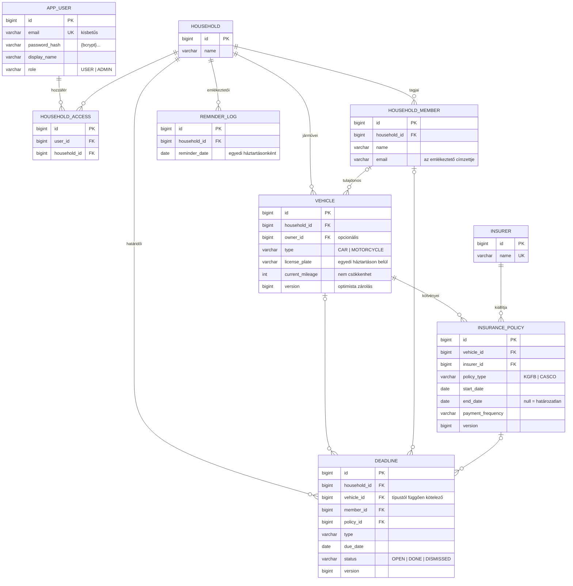
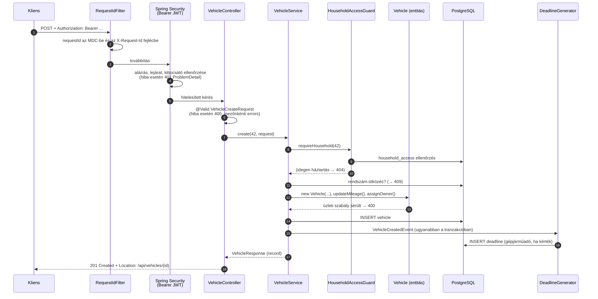

# Architektúra-áttekintés

A Family Fleet egy Spring Boot 4 (Java 21) alapú REST API, amely családi háztartások járműveit,
biztosításait és határidőit tartja nyilván, és e-mailben emlékeztet a közelgő határidőkre.
Egyetlen telepíthető alkalmazás (moduláris monolit), PostgreSQL-adatbázissal.

A részletes döntések az [ADR-ekben](adr) vannak:
- [ADR-0001](adr/0001-shared-deadline-entity.md): közös határidő-entitás
- [ADR-0002](adr/0002-deadline-generation-rules.md): határidők generálása és ismétlődése
- [ADR-0003](adr/0003-authentication-and-authorization.md): JWT-hitelesítés és háztartásszintű jogosultság

## Csomagok és rétegek

A kód funkció (feature) szerint van csomagolva. Egy csomagon belül klasszikus rétegek vannak:

| Réteg | Felelősség | Példa |
|---|---|---|
| Controller | HTTP: útvonal, státuszkód, `Location`, validáció indítása (`@Valid`). Csak `record` DTO-t fogad és ad vissza. | `VehicleController` |
| DTO | Az API-szerződés: külön Request és Response recordok, Bean Validation korlátokkal (a sémával egyezően). | `VehicleCreateRequest`, `VehicleResponse` |
| Service | Üzleti folyamat és tranzakció (`@Transactional(readOnly = true)` alapból), jogosultság-ellenőrzés, DTO ↔ entitás. | `VehicleService` |
| Entitás (domain) | Üzleti szabályok és invariánsok, setterek helyett üzleti metódusokkal. | `Vehicle.updateMileage()`, `Deadline.dismiss()` |
| Repository | Adatelérés: Spring Data JPA, JPQL, Specification. | `DeadlineRepository.findOpenDueUntil()` |
| Adatbázis | Séma Flyway-migrációkkal; elnevezett megkötések mint végső védelem. | `uq_vehicle_household_plate`, `ex_policy_kgfb_no_overlap` |

```text
hu.familyfleet
├── common      hibakezelés (ProblemDetail), lapozás, Clock, kérésazonosító, OpenAPI
├── security    felhasználók, regisztráció/bejelentkezés, JWT, végpontszabályok
├── household   háztartás, családtag, háztartás-hozzáférés (HouseholdAccessGuard)
├── vehicle     járművek
├── insurance   biztosítók, kötvények
├── deadline    határidők, dátumszabályok (DeadlineCalendar, DeadlineRecurrence), generálás
└── reminder    napi emlékeztető e-mail
```

**Függőségi irány:** `deadline` → `insurance` → `vehicle` → `household` → `security`, és mindenki
használja a `common`-t. A visszafelé irányuló kapcsolatokat domain-események bontják fel: a
`vehicle` és az `insurance` csomag eseményt publikál (`VehicleCreatedEvent`,
`PolicyCreatedEvent`), amire a `deadline` csomag iratkozik fel. Így nincs körkörös
csomagfüggés.

## Adatmodell



Fontosabb adatbázis-szintű szabályok (a kód is ellenőrzi őket, az adatbázis a versenyhelyzetek
és a kódot megkerülő írások ellen véd):

| Megkötés | Szabály |
|---|---|
| `uq_vehicle_household_plate` | Egy rendszám háztartásonként egyszer |
| `ex_policy_kgfb_no_overlap` | Egy járműnek nem lehet két átfedő érvényességű KGFB-je (`EXCLUDE USING gist`) |
| `ck_deadline_required_link` | A határidő típusa szerinti kapcsolat kötelező (pl. műszaki vizsga → jármű) |
| `ck_deadline_completed_at` | Teljesítési időpont pontosan a DONE állapotú határidőnél |
| `uq_reminder_log_household_date` | Háztartásonként naponta legfeljebb egy emlékeztető |
| `uq_household_access_user_household` | Egy felhasználó–háztartás páros egyszer |

A részleges index (`idx_deadline_open_due … WHERE status = 'OPEN'`) a leggyakoribb lekérdezést, a
közelgő nyitott határidőket szolgálja ki.

## Egy kérés útja

Példa: `POST /api/households/42/vehicles` egy bejelentkezett felhasználótól.



Bármely lépés hibája a `GlobalExceptionHandler`-hez jut, és egységes RFC 9457 ProblemDetail
(`application/problem+json`) lesz belőle, benne a `requestId`-vel. A 401 és a 403 a Spring
Security láncából a `HandlerExceptionResolver`-en keresztül jut ugyanoda.

| Helyzet | Státusz |
|---|---|
| Hiányzó vagy érvénytelen token, rossz jelszó | 401 |
| Hiányzó szerepkör (pl. biztosító felvétele `USER`-ként) | 403 |
| Nem létező vagy idegen háztartáshoz tartozó erőforrás | 404 |
| Formai hiba (validáció, hibás JSON, rossz paraméter) | 400, mezőnkénti `errors` listával |
| Üzleti szabály (csökkenő km-óra, záró dátum a kezdő előtt) | 400 |
| Ütközés (duplikált rendszám, átfedő KGFB, párhuzamos módosítás, lezárt határidő) | 409 |
| Váratlan hiba | 500, belső részletek nélkül |

## Háttérfolyamatok

**Határidő-generálás (ADR-0002).** Járműfelvételkor (opcionálisan) gépjárműadó, kötvény
létrehozásakor KGFB-évforduló és díjfizetés jön létre. Teljesítéskor az ismétlődő típusok
következő határideje is létrejön. A dátumszabályok tiszta függvények (`DeadlineCalendar`,
`DeadlineRecurrence`), a „mai napot” az injektált `Clock` adja (Europe/Budapest).

**Napi emlékeztető.** Egy `@Scheduled` job reggel 7-kor összegyűjti a pontosan 30, 7 és 1 nap
múlva esedékes nyitott határidőket, és háztartásonként egy összesítő levelet küld a tagok
e-mail-címére. Minden háztartás külön tranzakcióban megy; a `reminder_log` és annak egyedi
megkötése biztosítja, hogy ugyanarra a napra ne menjen ki két levél (idempotencia).

## Konfiguráció és üzemeltetés

| | `dev` (alapértelmezett) | `prod` |
|---|---|---|
| Adatbázis, SMTP | Docker Compose (PostgreSQL, Mailpit) | környezeti változók |
| Titkok | fejlesztői alapértékek | csak környezeti változóból, alapérték nélkül |
| Log | olvasható szöveg, SQL-log | JSON (ECS), requestId mezővel |
| Actuator | health, info, metrics, loggers, … | csak health és info |
| Swagger UI | be | alapból ki |

## Minőség és szállítás

- **Tesztpiramis:**
  - unit tesztek (domain, dátumszabályok, Mockito service-tesztek);
  - web slice (`@WebMvcTest`);
  - repository-tesztek (`@DataJpaTest`);
  - végponttól végpontig integrációs tesztek valódi PostgreSQL-lel és valódi JWT-vel
    (Testcontainers, egyetlen közös konténer).
- **CI (GitHub Actions):** minden PR-ra és a `main`-re `./mvnw verify`, vagyis tesztek, JaCoCo
  lefedettségi kapu (80%) és Spotless formázás-ellenőrzés; utána Docker-image build.
- **Docker:** multi-stage build, réteges JAR, nem root felhasználó, `prod` profil.
